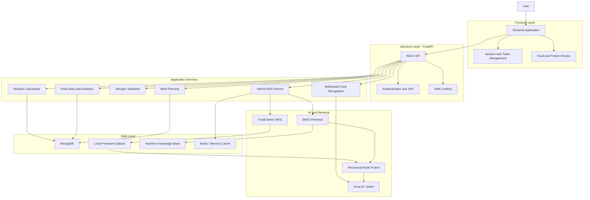

# AaharaLens — Multimodal AI-Powered Personalized Nutrition Platform

\<p align="center">
&#x20; \
&#x20; \
&#x20; \
&#x20; \
&#x20; \
&#x20; \
&#x20; \
&#x20; \
&#x20; \
&#x20; \
\</p>

**AaharaLens** is an AI-powered personalized nutrition platform that combines multimodal food recognition, nutrition analysis, hybrid Retrieval-Augmented Generation (RAG), and personalized meal planning.

Built with **Python, FastAPI, Streamlit, MongoDB, Qdrant, and Groq AI**, it helps users understand the nutritional composition of food, track daily meals, explore dietary information, and generate meal plans based on personal goals and dietary restrictions.

The platform separates AI-based food recognition from numerical nutrition calculations to make nutritional estimates more transparent and consistent.

---

## 1. Problem Statement

Traditional food-tracking applications often depend on manually entered food information or AI-generated nutritional estimates.

However, estimating nutrition directly from an image or a language model can introduce inconsistencies because:

- Food portion sizes vary significantly.
- Similar-looking dishes can have different ingredients.
- Hidden oils, sauces, and preparation methods are difficult to identify visually.
- Language models may generate inaccurate nutritional values.
- Dietary restrictions and allergies require additional validation.

### Our Approach

AaharaLens uses a multi-stage architecture:

1. **Food Recognition:** Multimodal AI identifies food items and estimates their visible portions from uploaded images or text.
2. **Nutrition Calculation:** A dedicated nutrition service calculates nutritional values using food composition references and portion scaling.
3. **Transparent Estimates:** When an exact food composition match is unavailable, the system identifies the result as an estimate rather than presenting it as a verified value.
4. **Allergen Validation:** A centralized service checks dietary selections against supported allergen categories.
5. **User Review:** Recognized foods and portion quantities can be reviewed and adjusted before being added to the food diary.

---

## 2. Key Features

### Multimodal Food Analysis

- Analyze food images using Groq-powered vision inference.
- Supports common image formats such as JPG, PNG, and WEBP.
- Identify multiple food items in a single image.
- Review and adjust detected food items and portion quantities.

### Nutrition Analysis

- Calculate calories and macronutrients based on portion weight.
- Provide nutritional breakdowns for protein, carbohydrates, fat, fiber, sugar, and sodium.
- Include selected micronutrients such as iron, calcium, potassium, magnesium, and vitamin C where reference data is available.
- Generate a deterministic heuristic health score based on selected nutritional factors.
- Distinguish reference-based results from estimated food compositions.

### Hybrid RAG Nutrition Assistant

- Answer nutrition-related questions using a curated knowledge base.
- Combine BM25 keyword retrieval with dense vector search.
- Generate embeddings locally using BGE-small through FastEmbed and ONNX Runtime.
- Combine retrieval rankings using Reciprocal Rank Fusion (RRF).
- Use retrieved context to ground AI-generated responses.

### Personalized Meal Planning

- Calculate Basal Metabolic Rate (BMR) and Total Daily Energy Expenditure (TDEE) using the Mifflin-St Jeor equation.
- Support fitness and dietary goals.
- Generate multi-day meal plans.
- Apply allergen and dietary preference filters.
- Generate categorized grocery lists.
- Suggest suitable next meals based on remaining daily nutrition targets.

### Food Diary and Analytics

- Log daily food consumption.
- Track calories and macronutrients.
- Calculate daily nutrition totals.
- View rolling nutrition trends and food consumption analytics.

### Security and Authentication

- Secure password hashing using Argon2id.
- Legacy PBKDF2 password migration support.
- JWT-based authentication.
- Refresh token rotation and revocation.
- Refresh token replay detection.
- User-isolated conversations and application data.
- API rate limiting and request validation.

---

## 3. Technology Stack

| Layer                | Technologies                      |
| -------------------- | --------------------------------- |
| Programming Language | Python                            |
| Backend              | FastAPI, Uvicorn, Pydantic        |
| Frontend             | Streamlit, Plotly                 |
| AI and Vision        | Groq API, Qwen model              |
| Embeddings           | FastEmbed, BAAI/bge-small-en-v1.5 |
| Retrieval            | BM25, Dense Vector Search, RRF    |
| RAG Framework        | LlamaIndex                        |
| Vector Database      | Qdrant                            |
| Primary Database     | MongoDB / MongoDB Atlas           |
| Caching              | Redis, In-Memory TTL Cache        |
| Authentication       | Argon2id, JWT                     |
| Rate Limiting        | SlowAPI                           |
| Image Processing     | Pillow                            |
| Testing              | Pytest, Pytest-Cov                |
| Version Control      | Git, GitHub                       |

---

## 4. System Architecture



### Important Design Decisions

**1. Separation of Recognition and Calculation**

Vision AI identifies food items, while the nutrition service handles numerical calculations. This reduces dependence on language-model-generated nutritional numbers.

**2. Hybrid Retrieval**

BM25 helps retrieve exact food and nutrient terminology, while dense embeddings identify semantically related information. Reciprocal Rank Fusion combines the rankings.

**3. Local Embedding Inference**

BGE embeddings are generated locally through FastEmbed and ONNX Runtime, avoiding a paid external embedding API.

**4. Single-Process Vector Storage**

The Windows-native setup uses persistent local Qdrant storage managed by the FastAPI backend. A single-worker backend configuration avoids multiple processes competing for the same local storage.

**5. Resilient Caching**

Redis can be used when available. A thread-safe in-memory TTL cache provides a fallback when Redis is unavailable.

---

## 5. Project Structure

```text
AaharaLens/
│
├── .github/
│   └── workflows/
│       └── ci.yml
│
├── data/
│   ├── knowledge/
│   │   ├── clinical_nutrition_guidelines.md
│   │   ├── indian_food_nutrition.md
│   │   └── micronutrients_and_comparisons.md
│   └── nutrition_facts.txt
│
├── scripts/
│   ├── check_services.ps1
│   ├── start_backend.ps1
│   ├── start_frontend.ps1
│   └── stop_application.ps1
│
├── src/
│   ├── core/
│   │   ├── config.py
│   │   ├── limiter.py
│   │   └── security.py
│   │
│   ├── repositories/
│   │   └── database.py
│   │
│   ├── routes/
│   │   ├── auth_routes.py
│   │   ├── chat_routes.py
│   │   ├── deps.py
│   │   ├── food_routes.py
│   │   ├── meal_routes.py
│   │   ├── planner_routes.py
│   │   └── profile_routes.py
│   │
│   ├── schemas/
│   │   └── nutrition_schemas.py
│   │
│   ├── services/
│   │   ├── ai_service.py
│   │   ├── allergen_service.py
│   │   ├── cache_service.py
│   │   ├── meal_planner_service.py
│   │   ├── meal_service.py
│   │   ├── nutrition_service.py
│   │   └── rag_service.py
│   │
│   ├── ai_model.py
│   └── main.py
│
├── tests/
│   ├── conftest.py
│   ├── test_api.py
│   ├── test_auth_regression.py
│   ├── test_nutrition.py
│   ├── test_rag_and_features.py
│   └── ...
│
├── .env.example
├── .gitignore
├── app.py
├── check.py
├── pytest.ini
└── requirements.txt
```

Local environment files, downloaded models, persistent vector data, and backups are excluded from version control.

---

## 6. Installation and Setup

### Prerequisites

- Windows 10 or Windows 11
- Python 3.11 or newer
- Git
- Groq API key
- MongoDB Atlas or a local MongoDB instance

Redis is optional because the application supports an in-memory caching fallback.

**The application runs natively on Windows. Docker Desktop and WSL are not required.**

### Step 1: Clone the Repository

```powershell
git clone https://github.com/anjali9555/AaharaLens.git

cd AaharaLens
```

### Step 2: Create a Virtual Environment

```powershell
python -m venv .venv

.\.venv\Scripts\Activate.ps1
```

If PowerShell blocks script execution, use the following command for the current terminal session:

```powershell
Set-ExecutionPolicy -Scope Process -ExecutionPolicy Bypass
```

Then activate the environment again.

### Step 3: Install Dependencies

```powershell
python -m pip install --upgrade pip

pip install -r requirements.txt
```

### Step 4: Configure Environment Variables

Create your local environment file:

```powershell
Copy-Item .env.example .env
```

Open `.env` and configure the required credentials.

---

## 7. Environment Configuration

Important environment variables:

| Variable               | Purpose                            |
| ---------------------- | ---------------------------------- |
| `ENVIRONMENT`          | Application environment            |
| `GROQ_API_KEY`         | Groq API authentication            |
| `GROQ_MODEL`           | Language model selection           |
| `GROQ_VISION_MODEL`    | Vision model selection             |
| `SECRET_KEY`           | JWT signing secret                 |
| `ADMIN_API_KEY`        | Administrative endpoint protection |
| `MONGODB_URI`          | MongoDB connection URI             |
| `MONGODB_DB_NAME`      | Application database name          |
| `REDIS_URL`            | Optional Redis connection          |
| `BACKEND_URL`          | FastAPI URL used by Streamlit      |
| `EMBEDDING_MODEL_NAME` | Local embedding model              |
| `EMBEDDING_CACHE_DIR`  | Embedding model cache directory    |
| `USDA_API_KEY`         | Optional USDA API key              |

**Security recommendations:**

- Never commit `.env` to GitHub.
- Replace all placeholder secrets with strong, randomly generated values.
- Use a restricted MongoDB database user.
- Do not expose administrative API keys.
- Configure production settings before deploying publicly.

The first initialization of the embedding model may require downloading model files. These are cached locally for subsequent runs.

---

## 8. Running the Application

AaharaLens provides PowerShell scripts for native Windows execution.

### Terminal 1 — Start Backend

```powershell
.\scripts\start_backend.ps1
```

FastAPI runs at:

`http://127.0.0.1:8000`

### Terminal 2 — Start Frontend

```powershell
.\scripts\start_frontend.ps1
```

Streamlit runs at:

`http://127.0.0.1:8501`

### API Documentation

Once the backend is running:

- Swagger UI: `http://127.0.0.1:8000/docs`
- ReDoc: `http://127.0.0.1:8000/redoc`

### Service Monitoring

Check application services:

```powershell
.\scripts\check_services.ps1
```

Stop application processes:

```powershell
.\scripts\stop_application.ps1
```

The backend is configured to run with a single Uvicorn worker to maintain ownership of the local persistent Qdrant storage.

---

## 9. API Modules

The FastAPI backend organizes functionality into the following API modules:

| Module         | Responsibilities                                                   |
| -------------- | ------------------------------------------------------------------ |
| Authentication | Registration, login, token refresh, and logout                     |
| Profile        | User preferences, BMR, and TDEE                                    |
| Food           | Food search, image analysis, nutrition comparison, and substitutes |
| Meals          | Food diary, daily totals, and nutrition analytics                  |
| Planner        | Meal plan generation and grocery lists                             |
| Chat           | Nutrition assistant, RAG retrieval, and knowledge-base operations  |

Interactive endpoint details and request schemas are available through the Swagger documentation at `/docs`.

---

## 10. Testing and Code Quality

AaharaLens includes automated tests for:

- API routes and application behavior
- Authentication and token lifecycle
- Password hashing and security controls
- Nutrition calculations and portion scaling
- Allergen filtering and substitutions
- AI image processing
- Hybrid RAG and vector retrieval
- Caching behavior
- Database operations
- Windows-native service reliability

### Run Tests

Activate the virtual environment and execute:

```powershell
python -m pytest -v --cov=src --cov-report=term-missing
```

### Latest Reported Test Results

| Metric        | Result |
| ------------- | -----: |
| Total Tests   |     82 |
| Passed        |     82 |
| Failed        |      0 |
| Code Coverage |    80% |
| Statements    |  2,701 |

These results represent the latest reported local test run; results may vary with environment and dependency versions.

---

## 11. Current Limitations

- **Food Portion Estimation:** A 2D image cannot determine exact food weight, internal ingredients, or hidden cooking oils. Users should review and adjust portion estimates.
- **Nutrition Data Availability:** Food composition coverage depends on available reference data. Some foods may require approximate composite estimates.
- **Allergen Safety:** Software-based allergen screening cannot guarantee protection against cross-contamination or undisclosed ingredients.
- **Third-Party AI Dependency:** AI-powered image recognition and language generation require a working Groq API connection and are subject to its service availability and usage limits.
- **External Database Services:** MongoDB and optional Redis behavior depends on the configured services. Local fallback behavior has its own persistence and scaling limitations.

### Medical Disclaimer

AaharaLens is intended for general nutritional awareness and educational purposes. It is not a substitute for professional medical advice, diagnosis, or individualized dietary treatment.

Users with medical conditions or severe food allergies should consult qualified healthcare professionals.

---

## 12. Future Improvements

Potential areas for further development include:

- Expanded verified food composition datasets.
- Improved regional food and portion recognition.
- More comprehensive nutritional recommendations.
- Additional integration and end-to-end testing.
- Deployment and production monitoring improvements.

---

## Author

**Anjali Agrawal**

- GitHub: [@anjali9555](https://github.com/anjali9555)
- Project: [AaharaLens](https://github.com/anjali9555/AaharaLens)

---

\<p align="center">   \<b>AaharaLens — Making personalized nutrition more accessible through AI and data-driven insights.\</b> \</p>
